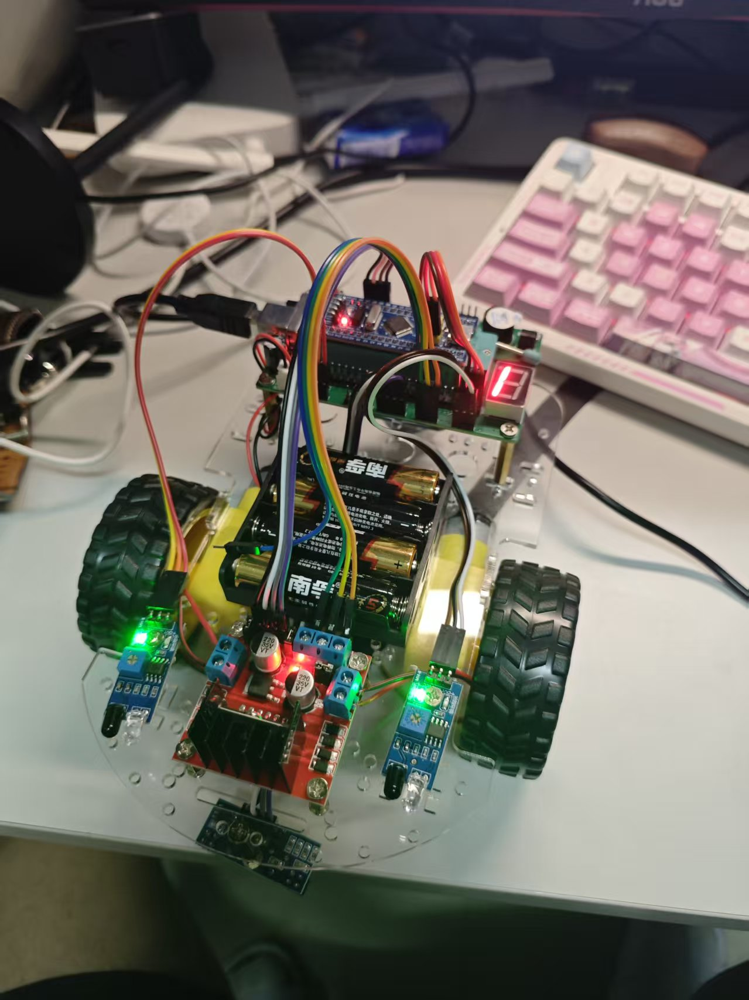
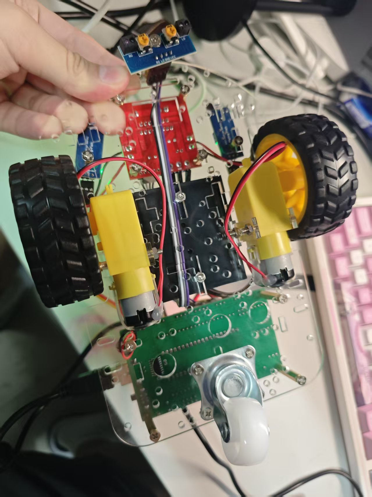

# STM32 红外智能小车

这是一个基于 STM32F103C8T6 的两轮差速智能小车工程，使用 Keil MDK 和 STM32F10x 标准外设库开发。

本仓库只保留最终的三模式综合程序，不包含 Keil 安装包、Device Pack、教学视频、电子书、驱动程序、压缩包、K210 视觉循迹扩展或编译中间文件。

## 实物展示

### 整车与上层接线



### 底盘与循迹传感器



照片用于展示实际装配；具体引脚连接请参考 [接线说明](docs/pinout.md)。

## 功能

- 红外循迹：两路循迹传感器检测轨迹，通过左右轮差速修正方向。
- 红外避障：两路避障传感器检测障碍物，并控制小车转向或原地旋转。
- 红外遥控：支持前进、后退、左转、右转和停止。
- 按键切换模式：数码管显示 `1`、`2`、`3`，分别代表循迹、避障和遥控模式。
- 串口调试：USART1 使用 9600 波特率输出红外接收信息。

## 硬件

- STM32F103C8T6 开发板
- 双路直流电机驱动模块，原设计报告使用 L298N
- 两个直流减速电机和小车底盘
- 两路红外循迹传感器
- 两路红外避障传感器
- 红外接收头和遥控器
- 一位数码管及独立按键
- 电池和稳压供电模块

完整引脚定义见 [docs/pinout.md](docs/pinout.md)。

## 目录结构

```text
firmware/stm32/
├─ Hardware/       外设和小车控制驱动
├─ Library/        STM32F10x 标准外设库
├─ Start/          CMSIS、系统与启动文件
├─ System/         延时模块
├─ User/           主程序和中断文件
└─ Project.uvprojx Keil 工程
docs/
├─ build.md        编译和烧录说明
└─ pinout.md       引脚和接线说明
```

## 使用方法

1. 安装 Keil MDK 5、ARM Compiler 5 和 STM32F1 Device Family Pack。
2. 打开 `firmware/stm32/Project.uvprojx`。
3. 选择 `Target 1` 并编译工程。
4. 使用 ST-Link 或开发板支持的串口下载方式烧录。
5. 上电后按 PA15 对应的独立按键切换工作模式。

详细步骤见 [docs/build.md](docs/build.md)。

## 当前限制

- 代码基于较旧的 STM32 标准外设库和 ARM Compiler 5，尚未迁移到 STM32Cube HAL。
- 控制逻辑大量使用阻塞延时，不适合作为实时控制框架。
- 当前三种功能通过模式切换分别运行，循迹与主动绕障不会同时执行。
- 红外遥控模式的原始实现采用阻塞式扫描，进入该模式后建议通过复位重新开始模式选择。
- 历史编译记录显示综合工程可以生成固件。本仓库已经修复红外命令未初始化和函数声明警告，但发布正式版本前仍需重新编译并进行硬件测试。

## K210 视觉循迹

原资料包还包含 K210 摄像头视觉循迹示例。它属于独立扩展功能，最终三模式工程不依赖它，因此没有包含在本仓库中。

## 许可状态

本仓库包含 STMicroelectronics 和 Arm 的第三方源码。相关版权声明保留在源文件中，详情见 [THIRD_PARTY_NOTICES.md](THIRD_PARTY_NOTICES.md)。

当前没有为整个仓库声明统一的开源许可证。公开发布者需要确认应用代码和教学示例的权属后，再决定是否为自己拥有版权的部分添加 MIT、Apache-2.0 或其他许可证。

